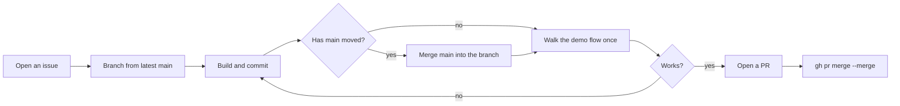

# AGENTS.md · Development rules

> Rules for Claude Code, Codex and human contributors. `CLAUDE.md` only imports this file.

## 1. This repo

Our entry for the c0mpiled-18 YC Startup School Hackathon (Taipei, 2026-11-11), built during the event (18:45–22:45).

**unify-risk: your health numbers, explained by formulas you can check.** A person answers a questionnaire and adds lab values. Published formulas turn those into risk estimates. Every number opens to show the equation, the source, and the populations the formula was validated in.

## 2. Development

- **`main` must always run and be demo-ready.** Do not merge anything broken.
- **No tests, no test suites, no type checks, no code review.** After a change, start the app, walk through the demo flow once, and report what you saw.
- **Open an issue before you build anything.** Give it a short title, what will be visible when it is done, and the files you expect to touch, then assign it to yourself. The issue list is how everyone sees who is building what, so check it before you start (`gh issue list`) to avoid doing the same thing twice.
- **Edit only the files you own.** One branch does one thing; merge as soon as it works.
- Follow the data formats in [`docs/interfaces.md`](docs/interfaces.md). Do not change a shared format on your own; ask first.
- Ask before touching shared files: `index.html`, `server.py`, `js/app.js`, `js/store.js`, `js/api.js`, `css/app.css`, `README.md`, `AGENTS.md`.
- Wire modules together with hard-coded fake data first, then replace it with the real thing. Nobody should wait on anybody else.
- Stuck for 20 minutes? Say so in the group chat.
- API keys go in `.env` only, never in the repo, a PR or an issue. When you add an environment variable, update `.env.example` (name and purpose only).
- **Never print the real values in `.env`.** Do not `cat`, `grep`, `echo` or otherwise display the file or its values, and do not write them to logs, error messages, API responses, terminal output, commits, PRs or issues. To check a key, test only whether it is set (for example `GET /api/health` lists provider names), never what it is.
- Use only published papers and formulas. No private or research datasets. Every sample person is fictional.

## 3. Product wording

- Every page carries the disclaimer: Not a diagnosis. Not medical advice.
- Do not use "diagnose", "screen" or "detect". Use "estimate" and "published formula".
- Every number on screen opens to show its equation and source. If a formula cannot be computed, say what is missing. If the person is outside the formula's range, show "not applicable"; never extrapolate.

## 4. Language

- **Everything in this repo is in English**: code, comments, UI text, docs, commit messages, PR titles and PR descriptions.

## 5. Git



- Never commit directly to `main`: branch → PR → merge. Branch names are `<type>/<topic>`, for example `feat/inputs` or `fix/router`.
- Always merge with `gh pr merge <n> --merge`. No squash, no rebase. No review is required: walk the demo flow yourself, then merge.
- When `main` moves, merge `main` into your branch. Do not rebase a pushed branch.
- No `git push --force`. No `git reset --hard origin/main`.
- Name the branch after the issue, for example `feat/12-inputs`, and put `Closes #12` in the PR description so the issue closes on merge.
- PR descriptions follow `.github/pull_request_template.md`. **If you did not verify something, write "Not verified".**
- Commit messages: first line in the imperative says what changed, for example `Add FSRP stroke model`; the body says why.
- No AI attribution in commits or PRs: no `Co-Authored-By: ...`, no "Generated with ...".
- Running two agent tasks at once? Give each its own folder with `git worktree`.

## 6. Schedule

| Time | What |
| --- | --- |
| 18:45 | Start. One person pushes the skeleton; everyone else starts in their own files |
| 20:00 | **Integration 1**: `main` runs the demo flow end to end on fake data; decide what to cut |
| 21:45 | **Integration 2 and feature freeze**: bug fixes and visual fixes only; tag `demo-2145` |
| 21:45–22:25 | Edit the 90-second video, finish the README |
| 22:25–22:45 | Upload the video and submit |

## 7. Stack and how to run

- **Static web app**: HTML, CSS and plain JavaScript (ES modules). No framework, no build step, no packages. A person's data stays in the browser's `localStorage`.
- **One small server**, `server.py`, standard library only. It serves the static files and forwards `POST /api/<name>` to `api/<name>.py`. API keys are read from `.env` on the server and never appear in client code.
- File owners and the data formats between modules are in [`docs/interfaces.md`](docs/interfaces.md).
- Run:

  ```bash
  uv run python server.py
  ```

  Then open <http://127.0.0.1:8000/>.
- Python always goes through `uv`. Do not use `pip` or call `python` directly.
