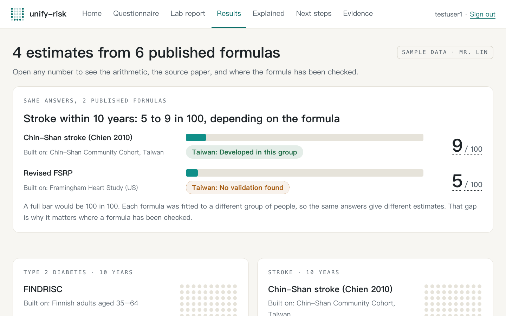
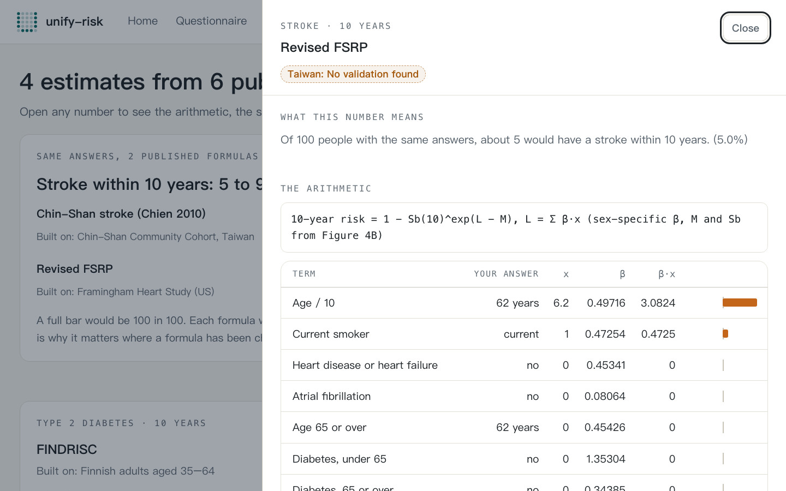
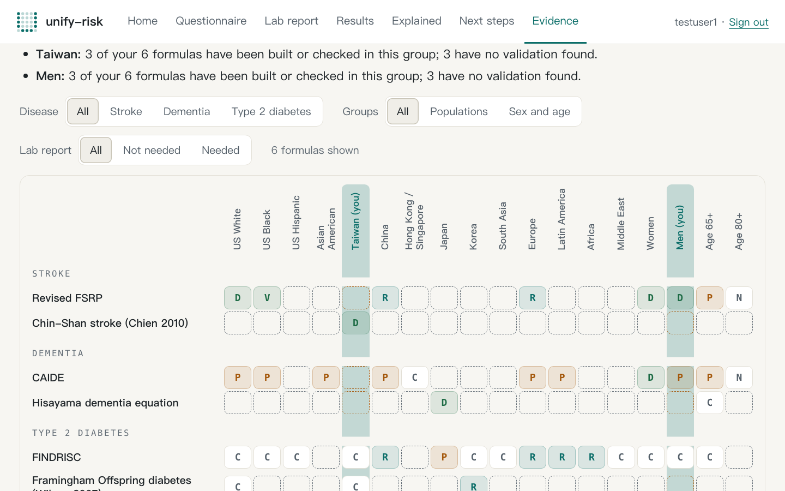
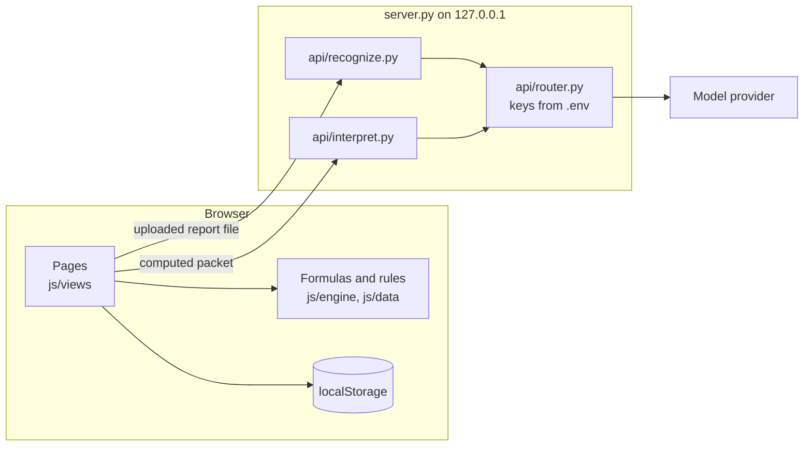

# unify-risk

**Your health numbers, explained by formulas you can check.**

> Not a diagnosis. Not medical advice. Every sample person and sample report in this repo is fictional.

A risk formula is fitted to one group of people. It is often used on another group without anyone saying so. unify-risk takes a person's questionnaire answers and lab values, runs published formulas for stroke, dementia and type 2 diabetes, and shows three things next to each estimate: which formula produced it, where that formula was built, and whether it has been checked in people like you.

Every risk estimate opens to show the arithmetic term by term, the source paper, and the populations the formula has been checked in. When a formula cannot be computed, the app names the missing input. When a person is outside a formula's range, the app says "not applicable" and does not extrapolate.

Built at the c0mpiled-18 YC Startup School Hackathon, Taipei, 2026-11-11.



## Contents

- [Quick start](#quick-start)
- [A two-minute tour](#a-two-minute-tour)
- [The formulas](#the-formulas)
- [Where a model is used and where it is not](#where-a-model-is-used-and-where-it-is-not)
- [Evidence data](#evidence-data)
- [Privacy and safety](#privacy-and-safety)
- [Project layout](#project-layout)
- [Architecture](#architecture)
- [Known limits](#known-limits)
- [Team](#team)
- [Contributing](#contributing)

## Quick start

You need [uv](https://docs.astral.sh/uv/) and a browser. There is no build step and nothing to install: the front end is plain HTML, CSS and JavaScript modules, and the server uses only the Python standard library.

```bash
cp .env.example .env        # optional: add a key for any provider you have
uv run python server.py
```

Open <http://127.0.0.1:8000/> and sign in with a test account. There is no password.

| Account | Sample person |
| --- | --- |
| `testuser1` | Mr. Lin, 62, Taipei. Smokes, blood pressure untreated |
| `testuser2` | Linda, 58, Ohio. On blood-pressure medicine |
| `testuser3` | Mr. Chen, 64, Taichung. Retired civil servant, with four yearly reports |

The home page lists six more sample people. Picking one loads that person into the signed-in account.

### Keys

**The app runs with no key.** A key only switches on the two model calls described [below](#where-a-model-is-used-and-where-it-is-not). Names and purposes are in [`.env.example`](.env.example):

| Variable | Provider | Reads |
| --- | --- | --- |
| `CLAUDE_API_KEY` | Claude API (Anthropic) | images and PDFs |
| `JOHNCLAUDE` | a second Claude API key | images and PDFs |
| `OPENROUTER_API_KEY` | OpenRouter | images |
| `OPENGSA_GEMINI_API_KEY` | Google Gemini API | images |
| `GROQ_API_KEY` | Groq | images |
| `NVIDIA_API_KEY` | NVIDIA API catalog | images |

- Reading a lab report uses only `JOHNCLAUDE`, then `CLAUDE_API_KEY`, then `OPENGSA_GEMINI_API_KEY` (images only, so it is skipped for a PDF).
- The Explained page tries every configured provider in the order of the table and moves to the next one when a call fails. `LLM_PROVIDER_ORDER` changes the order, `<NAME>_MODEL` overrides a provider's model, and `PORT` changes the port.
- <http://127.0.0.1:8000/api/health> lists the configured providers by name. It never returns a key.

With no key set:

- Every estimate, lab reading, next step and evidence table works as usual. None of them calls a model.
- The lab report page loads a fictional sample report and marks it "Demo data".
- The Explained page shows a reading prepared in advance for a sample person whose inputs are unchanged. For anyone else it says the written report is unavailable and still shows the computed details.

`.env` is git-ignored. Never commit it.

## A two-minute tour

Sign in as `testuser1` (Mr. Lin) and follow the navigation bar from left to right.

1. **Home.** The pitch, a "Start with your own answers" button and the nine sample people.
2. **Questionnaire.** 25 questions, one at a time. Each question lists the formulas that use the answer. Mr. Lin starts with 21 answered.
3. **Lab report.** Upload a PDF, PNG, JPEG or WebP of a check-up report (up to 10 MB), or choose "Use a sample report". Each value appears as a row with its unit, printed range and how clearly it was read. "Save to my record" stays disabled until you have ticked every row and the report date.
4. **Results.** The heading for Mr. Lin reads "4 estimates from 6 published formulas":

   | Formula | Result for Mr. Lin | Evidence badge for Taiwan |
   | --- | --- | --- |
   | FINDRISC | Type 2 diabetes within 10 years: about 1 in 3 (17 of 26 points) | Only discrimination reported |
   | Chin-Shan stroke | Stroke within 10 years: 8.5% (10 of 19 points) | Developed in this group |
   | Revised FSRP | Stroke within 10 years: 5.0% | No validation found |
   | CAIDE | Dementia within 20 years: 3.2% (8 of 15 points) | No validation found |
   | Framingham Offspring diabetes score | Not computed. Still needed: triglycerides | Only discrimination reported |
   | Hisayama dementia equation | Not applicable. Age 62 is outside 65 and over, the ages this formula was built on | None on this card |

   The top card puts the two stroke formulas side by side: the same answers give 9 in 100 from the formula built in Taiwan and 5 in 100 from the one built in the United States. Below the cards are what-if cards (for example systolic pressure 148 → 129 mmHg moves Chin-Shan from 8.5% to 6.0%) and each measurement and lab value read against a published standard.
5. **The equation drawer.** Choose "Show the math and source" on any card. For Revised FSRP the drawer lists each term with Mr. Lin's answer, x, β and β·x (age / 10: 6.2 × 0.49716 = 3.0824; current smoker: 0.4725; untreated systolic pressure: 0.765; sum 4.32). Then come the paper's own coefficients and tables, the cohort and citation, a row for each of the 18 population groups, and the paper's worked examples next to what this code computes.

   

6. **Explained.** A plain-English reading of the same results in three parts: your health right now, what this means for you, what you should do. Under it are the computed details the reading was written from.
7. **Next steps.** For Mr. Lin: three follow-up tests (repeat blood pressure, a lipid panel that would supply the missing triglycerides, repeat glucose or HbA1c) and public services in Taiwan. The quit-smoking helpline reads "Your values meet this rule". The free adult health check-up reads "May apply", because the app does not know whether he had one in the past 3 years. Switch the region to see services in the United States.
8. **Evidence.** A matrix of formulas by population groups. "In this app" shows the 6 formulas on the results page; "All 57" shows every formula reviewed. A dashed empty cell is a gap: no published check was found. The check table at the bottom re-runs the papers' worked examples in your browser and reports "22 of 22 printed examples reproduced".

   

## The formulas

The engine in [`js/engine/`](js/engine/) computes eight published formulas. Each is one file in `js/engine/formulas/`.

| Formula | Estimates | Built on | Inputs in brief | Source |
| --- | --- | --- | --- | --- |
| Revised FSRP | First stroke within 10 years | Framingham Heart Study, US, ages 55–84 | age, sex, smoking, systolic pressure and treatment, diabetes, atrial fibrillation, heart disease | Dufouil et al., Circulation 2017 |
| Chin-Shan stroke | Stroke within 10 years | Chin-Shan Community Cohort, Taiwan, ages 35 and over | age, sex, blood pressure, family history of stroke, atrial fibrillation, diabetes | Chien et al., Stroke 2010 |
| FINDRISC | Type 2 diabetes within 10 years | Finnish adults, ages 35–64 | age, BMI, waist, activity, vegetables and fruit, blood-pressure medicine, past high glucose, family history | Lindström and Tuomilehto, Diabetes Care 2003; bands from the Finnish Diabetes Association form |
| Framingham Offspring diabetes score | Type 2 diabetes within 8 years | Framingham Offspring Study, US | BMI, blood pressure, family history, fasting glucose, HDL, triglycerides | Wilson et al., Arch Intern Med 2007 |
| CAIDE | Dementia within 20 years | Finnish CAIDE cohort, ages 39–64 | age, sex, education, systolic pressure, BMI, total cholesterol, exercise | Kivipelto et al., Lancet Neurol 2006 |
| Hisayama dementia equation | Dementia within 10 years | Hisayama Study, Japan, ages 65 and over | age, sex, education, blood pressure, diabetes, BMI, past stroke, smoking | Honda et al., Alzheimers Dement (Amst) 2021 |
| ADA diabetes risk test | Points only (−1 to 9), no percentage | US adults, NHANES 1999–2004, ages 20 and over | age, sex, family history, blood-pressure medicine, BMI, activity | Bang et al., Ann Intern Med 2009 |
| BDSI | Points only (0–56), no percentage | Four US cohorts, ages 65–79 | age, education, BMI, diabetes, past stroke, help with money or medicines, depressive symptoms | Barnes et al., Alzheimers Dement 2014 |

**Six are shown.** The ADA test and BDSI are point scores with no published percentage. The engine leaves them out unless a caller passes `includeScores: true`, and no page does.

**Order.** Results come back largest estimate first, then formulas with a missing input, then formulas that do not apply. This is the size of the estimate, not urgency: outcomes and time horizons differ between formulas.

### How each formula is checked

`runChecks()` in [`js/engine/checks.js`](js/engine/checks.js) re-computes worked examples and table values printed in each formula's own source and compares them with the engine's output. The equation drawer and the Evidence page run it in the browser. To run it from a terminal (the engine is a plain ES module; this was run on Node 24):

```bash
node --input-type=module -e "const { runChecks } = await import('./js/engine/index.js'); const r = runChecks(); console.log(r.filter((c) => c.pass).length + ' of ' + r.length + ' reproduced');"
```

It prints `22 of 22 reproduced`: Revised FSRP 4, Chin-Shan 2, FINDRISC 3, CAIDE 3, Framingham Offspring 3, ADA 3, Hisayama 3, BDSI 1.

What these checks do not show:

- They are not a test suite. They cover the examples a source prints, not every combination of inputs. BDSI has one check.
- FINDRISC is computed from the 8-question form (0–26 points) and reports the band printed on the form, such as "about 1 in 3", not a continuous probability. The 2003 paper used 7 questions and asked about 4 hours of activity a week; the form asks about 30 minutes a day. The drawer says so.
- The Framingham Offspring score and the Chin-Shan score read their risk from the table printed in the paper. The ends of the Framingham Offspring table are open bands ("3% or less", "more than 35%").
- The Hisayama examples are printed to whole percents, so the comparison is at that precision.
- Revised FSRP and Chin-Shan were built on people with no previous stroke. When that answer is absent, the result carries the note "Assumes no previous stroke (not asked)".

## Where a model is used and where it is not

A model is used in exactly two places. It never computes an estimate.

**1. Reading values off an uploaded report** ([`api/recognize.py`](api/recognize.py))

- Sent to the provider: the uploaded file, whole, with instructions to copy the printed values into JSON (test, value, unit, printed range, the report's own high or low flag, a confidence) and not to interpret, calculate, or copy names, ID numbers or other identifying details.
- The person confirms: every row. Nothing is saved until each row and the report date are ticked. Rows read with medium or low confidence are highlighted. A value in a known other unit is converted; a value in a unit the app cannot convert blocks saving until it is corrected.

**2. Writing the reading on the Explained page** ([`api/interpret.py`](api/interpret.py))

- Sent to the provider: a trimmed copy of numbers the browser already computed. It holds the region and population groups, the questionnaire answers and lab values, each report's date and lab values, each formula result with its terms, the lab readings, the metabolic syndrome count, the evidence status for the person's groups, the what-ifs, and the matched services and follow-up tests. The server drops the person's name before the call.
- The instructions are part of [`docs/report-interpreter.md`](docs/report-interpreter.md), the guide the model writes from.
- The numbers are filtered: the server lists every number in the reply that appears in neither the packet nor the guide, and the page flags them. This is a coarse filter, not proof: a number passes if it appears anywhere in the packet or the guide, so the filter cannot tell whether the number is attached to the right result.
- For the nine fictional sample people, readings were prepared in advance (`js/data/readings.js`). The page shows one only while that person's inputs are unchanged, and then makes no call.

Everything else is a formula, a written rule or a data table that runs in the browser: the estimates, the lab reference ranges, the what-ifs, the follow-up tests and services, and the evidence matrix.

## Evidence data

Two generated data files sit behind the Evidence page and the drawer. Both are built by scripts in `tools/` and are not edited by hand.

**[`js/data/evidence.js`](js/data/evidence.js)**: where each published formula has been checked. 57 formulas (13 stroke, 19 dementia, 25 type 2 diabetes) by 18 groups: 14 populations, women, men, age 65+ and age 80+. It is generated from a matrix the team compiled from published validation studies. A cell can carry the observed / expected ratio, the C-statistic, the number of studies and the DOI of a representative paper. The status codes, as the file defines them:

| Code | Meaning |
| --- | --- |
| D | Developed in this group |
| V | Validated, calibration acceptable |
| R | Recalibrated version exists |
| C | Only discrimination reported |
| P | Checked, poorly calibrated |
| G | No validation found |
| N | Not applicable |
| U | Not stratified in the papers |
| S | Single-sex model |

871 cells are G. The Evidence page reports this as 871 of 1,024 cells, or 85% of the map.

**[`js/data/coefficients.js`](js/data/coefficients.js)**: coefficients, constants, baseline survival, points tables and worked examples for 53 models, copied unchanged from each published paper, its supplement or the authors' code, with the table and page each number comes from. The drawer loads it to show "the equation, coefficients and tables as the paper prints them". The engine does not compute from this file; each formula file carries its own numbers.

No private or research dataset is used anywhere in this repo. The data comes from published papers and public service pages. Every sample person and every sample report is fictional ([`assets/sample-reports/README.md`](assets/sample-reports/README.md)).

## Privacy and safety

- **Data stays in the browser.** Answers, lab values, saved reports and saved readings are kept in `localStorage`, one record per test account. The server stores nothing.
- **Two things leave the machine**, and only when a key is set and you ask for them: a report file you upload, and the Explained packet when a live reading is needed. Both go to the local server and on to one model provider. The other pages make no API call.
- **Keys stay on the server.** They are read from `.env` or the environment, sent only to the provider's own API in a request header, and never returned to the browser.
- **The server is local and narrow.** It listens on `127.0.0.1` only. It serves `index.html` and files under `css/`, `js/` and `assets/`; everything else, including `.env`, `server.py`, `api/` and `docs/`, is a 404. A `POST /api/<name>` must carry this server's `Host`, this server's `Origin` when one is sent, and `Content-Type: application/json`, and its body must be 15 MB or less.
- **Sign-in is a demo.** Test accounts with no password, checked only in the browser. It separates sample people from each other; it does not protect data.

What the app deliberately does not do:

- It does not say that a person has or does not have a disease, and it gives no medical advice. Every page carries the disclaimer.
- It does not extrapolate. Outside a formula's age range, or where a formula excludes a previous stroke or existing diabetes, the result is "not applicable", with the reason.
- It does not guess a missing input. The card names what is missing and offers a shortcut to those questions.
- It does not recommend a medicine, a dose or a supplement.
- It does not claim a service match beyond what was checked. A service "meets" a rule only when nothing is left to confirm; otherwise it "may apply" and lists what was not checked.

## Project layout

```text
index.html                the only HTML file; loads js/app.js
server.py                 static file allowlist, GET /api/health, POST /api/<name>
api/
  router.py               one entry point for every model provider, with retry and fallback
  recognize.py            copy the printed values off a lab report
  interpret.py            write the Explained reading and filter its numbers
  chat.py                 chat endpoint; no page calls it
js/
  app.js                  hash router, sign-in gate, provider selector
  store.js, auth.js       localStorage record per account, demo sign-in
  api.js                  callApi(name, payload)
  views/                  one module per page: home, login, inputs, report, results, explain, plan, evidence
  engine/
    index.js              runAll, runFormula, runChecks, FORMULAS
    formulas/             one file per formula, eight files
    checks.js             the papers' worked examples
    labs.js               lab reference standards, metabolic syndrome count
    whatif.js             change one input, run the formulas again
    run.js                the engine as the pages see it
  data/
    personas.js           nine fictional sample people
    reports.js            fictional dated lab reports
    services.js           written rules for follow-up tests and public services
    evidence.js           generated: 57 formulas by 18 groups
    coefficients.js       generated: published coefficients for 53 models
    readings.js           generated: prepared readings for the sample people
css/app.css               shared styles
assets/sample-reports/    fictional report files (PDF and PNG) for trying the upload
tools/                    offline generators and the recognition check; not part of the app
docs/                     architecture.md, interfaces.md, report-interpreter.md, img/
```

## Architecture

A static front end plus one small Python server. The browser holds the person's record and runs every formula and rule. The server serves the files and holds the keys; it forwards two kinds of request to a model provider and stores nothing.



Full diagrams, the sequence for each flow, the data model and the security boundaries are in [`docs/architecture.md`](docs/architecture.md). Data formats between modules are in [`docs/interfaces.md`](docs/interfaces.md).

## Known limits

- **Eight formulas, six shown.** The evidence matrix covers 57 formulas; the engine computes eight of them and the pages show the six that give a probability.
- **Sample people cover some inputs only.** They were written around four formulas (Revised FSRP, Chin-Shan, FINDRISC, CAIDE). Mr. Lin and Linda have no triglycerides, so the Framingham Offspring score shows as missing for both.
- **FINDRISC's published table is not shown in the drawer.** The app computes the 8-question form; the coefficient file holds the 2003 paper's 7-question table, and the two would look like a mismatch side by side.
- **The checks cover printed examples.** 22 examples reproduce. That is not a proof that every input path matches the paper.
- **The number filter on the reading is coarse.** See [above](#where-a-model-is-used-and-where-it-is-not).
- **Service rules are a snapshot.** They are summaries read on 2026-11-11, each with its official source. The rules for the free adult health check-up and the quit-smoking services in Taiwan follow the team's own note and were not re-checked against a source page. Every card says which parts of a rule were not checked.
- **Two what-if lists.** The Results page and the Explained page each build their own list of changes from the same formulas, so they can show different changes (for Mr. Lin: systolic pressure to 129 mmHg on one, blood pressure to 120/80 on the other).
- **What-ifs compare two sets of answers.** The formulas come from observational studies; a what-if is not a promise of what a change would achieve.
- **Estimates are ordered by size**, across different outcomes and time horizons. The order is not urgency.
- **Local demo only.** The server binds to `127.0.0.1`, sign-in has no password, and the record lives in one browser. Clearing site data removes it.
- **Report reading needs a key.** Without one the page falls back to a fictional sample report. Only the two Claude API keys read PDFs.
- **No test suite.** The team's rules for the event set tests aside; `runChecks()` and a walk through the demo flow are the checks.

## Team

Four people, by the names used in [`docs/interfaces.md`](docs/interfaces.md):

- **Peter**: server, provider router, app shell and sign-in, Next steps and its rules.
- **Robert**: questionnaire, results cards and equation drawer, evidence page, styles.
- **Matt**: report recognition and the report page, evidence data, formulas.
- **Andrew**: formulas and lab standards, the Explained page, sample people and sample reports.

## Contributing

Development rules are in [`AGENTS.md`](AGENTS.md): open an issue, branch, pull request, merge commit. Data formats and file owners are in [`docs/interfaces.md`](docs/interfaces.md).
