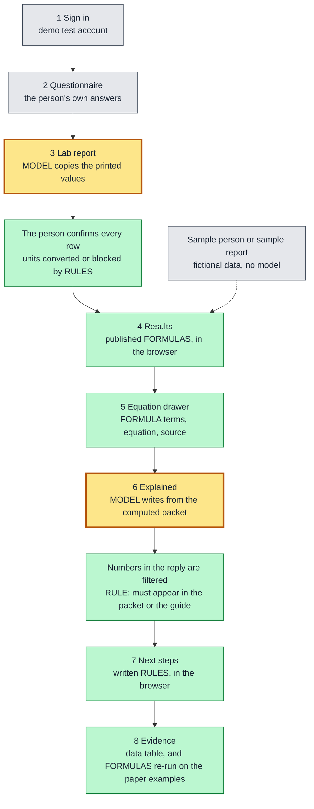
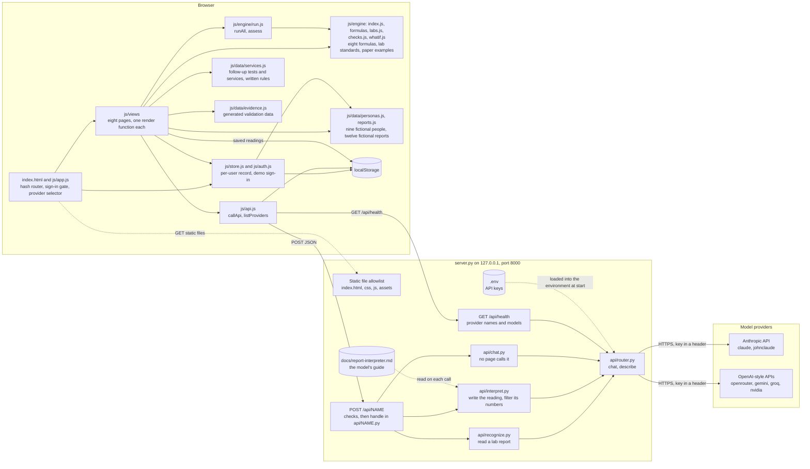
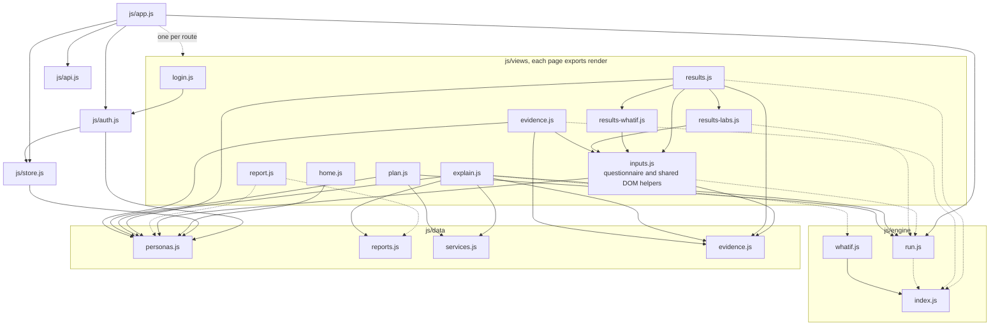
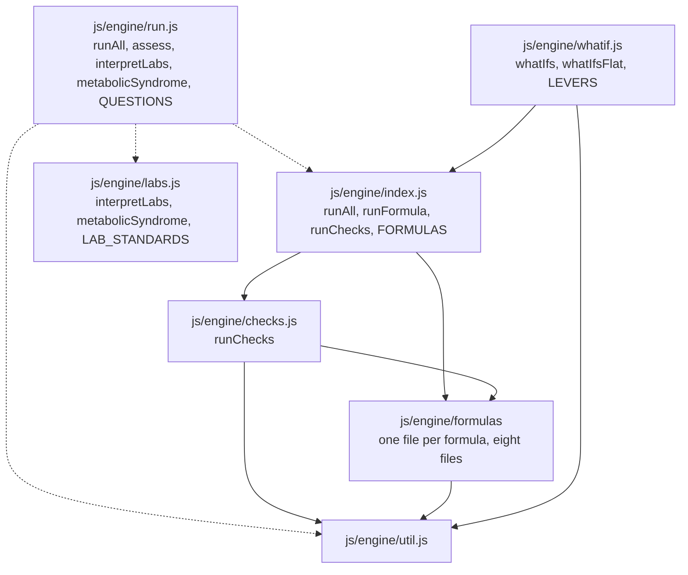
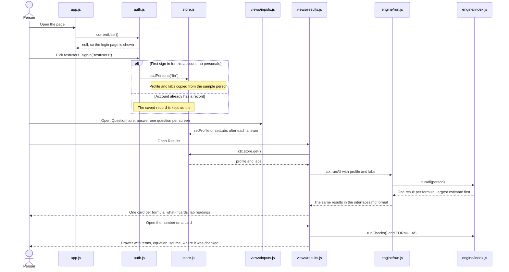
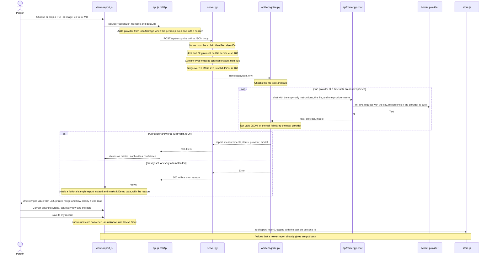
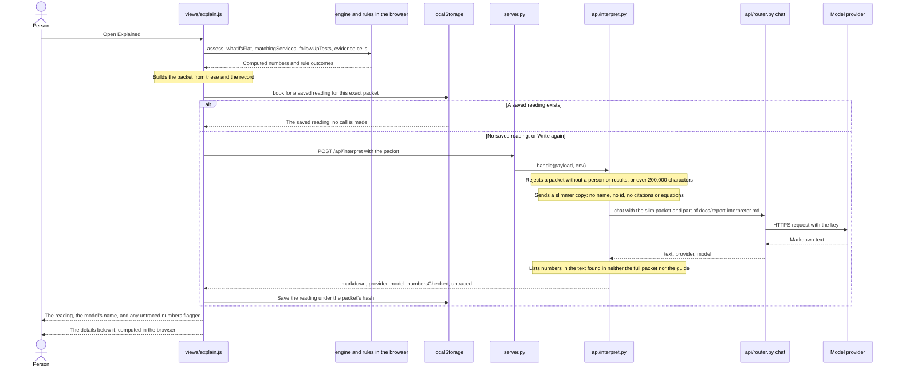
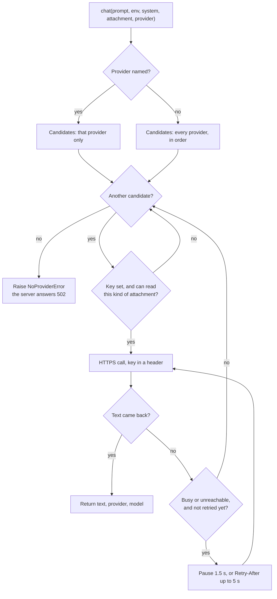

# Architecture

> How unify-risk fits together, as it is on `main` today. The detailed data formats are in [interfaces.md](interfaces.md); the development rules are in [AGENTS.md](../AGENTS.md).
> Every page in the navigation is built. The [status table](#status-on-main) says what is still thin.

## In short

unify-risk is a static web app (plain ES modules, no build step, no packages) plus one standard-library Python server. A person signs in with a demo test account, answers a questionnaire, adds a lab report and confirms every value read from it. Published formulas turn those answers into risk estimates. Each estimate opens to show its terms, its equation and its source. A written reading, the next steps and the evidence behind each formula follow.

A model is used in two places. It copies the printed values off an uploaded lab report, and it writes the plain-English reading on the Explained page from numbers that were already computed. It never computes an estimate. Every number comes from a published formula or a written rule that runs in the browser.

Yellow with a thick border: a model is involved. Green: deterministic formulas or written rules; the same inputs always give the same output and no model is called. Grey: the person's own input or fictional sample data.

- **Step 3.** The model only copies values. Nothing is saved until the person has ticked every row.
- **Step 6.** The model receives numbers the browser already computed and writes prose around them. The server then lists every number in the reply that appears in neither the packet nor the guide, and the page flags them. This is a coarse filter, not proof: it cannot tell whether a number is attached to the right result.

The main design decisions:

- **Static front end.** `index.html` loads `js/app.js`, a hash router that loads one view module per page on demand. A view that fails to load breaks only its own page.
- **The server is only a key-holding proxy.** `server.py` serves an allowlist of static files and forwards `POST /api/NAME` to `api/NAME.py`. API keys are read from `.env` on the server and never reach the browser.
- **A person's data is stored only in the browser.** Everything is kept in `localStorage`, one record per signed-in test account. The server stores nothing. Two things leave the browser, both to be passed to a model provider: an uploaded report file, and the packet for the Explained page. See [Security boundaries](#security-boundaries).
- **Formulas run in the browser.** `js/engine/run.js` adapts the formula engine (`js/engine/index.js`) and the lab reference standards (`js/engine/labs.js`) to the format in [interfaces.md](interfaces.md). No estimate is computed on the server. If the engine fails to load, `run.js` falls back to fixed results flagged `placeholder: true`.
- **Missing and out-of-range are answers.** A formula with a missing input says what is missing; a person outside a formula's range gets "not applicable". Nothing is guessed or extrapolated.
- **One router in front of every model provider.** Server modules call `chat()` in `api/router.py`; it retries a busy provider once, falls back to the next one on failure, and reports who answered.

## System overview

Notes on what the diagram shows:

- The dispatch is generic: any `api/NAME.py` that defines `handle(payload, env)` becomes `POST /api/NAME`. `main` has three: `recognize`, `interpret` and `chat`. `api/router.py` has no `handle`, so it is not an endpoint.
- Two pages call the server: the lab report page through `recognize`, and the Explained page through `interpret`. `api/chat.py` works but no page calls it.
- `docs/report-interpreter.md` is not served to the browser. `api/interpret.py` reads it from disk and uses part of it as the model's instructions.
- `js/data/coefficients.js` (generated coefficient tables for 53 models, built by `tools/build-coefficients.mjs`) is on `main` but is not in the diagram: no module imports it yet.
- `assets/sample-reports/` holds fictional lab report files (PDF and PNG) for trying the upload. The server serves them, but no page links to them; `tools/check_recognition.py` uses them to compare recognition output with the values they were printed from.

## Routes

| Hash | View | Uses a model |
| --- | --- | --- |
| `#/` | `home.js`: pitch and sample people | No |
| `#/login` | `login.js`: demo sign-in | No |
| `#/inputs` | `inputs.js`: questionnaire | No |
| `#/report` | `report.js`: upload a lab report, confirm each value | Yes, to copy the printed values |
| `#/results` | `results.js`: result cards, equation drawer, what-ifs, lab readings | No |
| `#/explain` | `explain.js`: the written reading, then the computed details | Yes, to write the reading |
| `#/plan` | `plan.js`: follow-up tests and public services | No |
| `#/evidence` | `evidence.js`: where each formula was checked | No |

`#/results?open=fsrp` opens the equation drawer for that formula. Every route except `#/login` needs a signed-in test account.

## Front-end modules

Solid arrows are static `import` statements. Dotted arrows are on-demand `import()` calls. The router loads a view when its page is opened. Views load engine files with `import()` and catch a failure, so a broken engine file removes one section instead of the page.

Every page view exports one function, `render(root, ctx)`. `root` is the emptied `<main>` element. `ctx` is the same object for every view:

| `ctx` member | Comes from | What it does |
| --- | --- | --- |
| `ctx.store` | `js/store.js` | Read and write the signed-in account's record |
| `ctx.runAll(person)` | `js/engine/run.js` | One result per formula for `{ profile, labs }` |
| `ctx.callApi(name, payload)` | `js/api.js` | `POST /api/NAME`; throws on any failure |
| `ctx.go(hash)` | `js/app.js` | Change page |
| `ctx.query()` | `js/app.js` | Query string after the hash path, as an object |

Things the graph shows that are easy to miss:

- **`inputs.js` is also a helper module.** The results views and the evidence view import its DOM helpers (`h`, `mount`), `personFrom`, `regionOf`, field labels and the disclaimer.
- **`results-whatif.js` and `results-labs.js` are sections, not pages.** `results.js` calls `whatIfSection` and `labsSection`. They have no route.
- **`results.js` and `evidence.js` import `js/engine/index.js` directly**, for `FORMULAS` and `runChecks`. Estimates still come through `ctx.runAll`.
- **`report.js` and `login.js` reach the rest of the app only through `ctx`** and, for `report.js`, on-demand sample data.
- `js/data/services.js`, `js/data/evidence.js`, `js/engine/labs.js` and `js/api.js` import nothing.

### The engine

- **`run.js` is the engine as the pages see it.** It loads the other files with `import()` and catches a failure, so a broken engine file degrades to placeholder results instead of a blank app. It translates the engine's own result shape (`id`, status `computed` and `not-applicable`) into the one in [interfaces.md](interfaces.md) (`modelId`, status `ok` and `not_applicable`).
- **`assess(person)`** returns `{ results, labs, metabolicSyndrome, placeholder }`: the formula results, one row per lab value or measurement with its reference standard and a plain-English reading, and the count of the five Taiwan metabolic syndrome criteria. The Explained and Next steps pages use it.
- **Eight formulas** are in `js/engine/formulas/`: revised FSRP and Chin-Shan (stroke); FINDRISC, the Framingham Offspring diabetes score and the ADA risk test (diabetes); CAIDE, the Hisayama equation and BDSI (dementia). Six give a probability. The ADA test and BDSI give points only and are left out unless a caller asks with `includeScores: true`; no page does, so the app shows six.
- **Order.** Results come back largest estimate first, then formulas with a missing input, then formulas that do not apply. This is the size of the estimate, not urgency: outcomes and time horizons differ between formulas.
- **`runChecks()`** re-computes the examples printed in each paper (22 checks) and returns `{ formulaId, example, expected, actual, pass, source }` for each. The equation drawer and the evidence page run it in the browser and show the outcome.
- **`whatif.js`** changes one input at a time on a copy of the person (smoking, blood pressure, weight, activity, vegetables, cholesterol), runs the same formulas again, and keeps the estimates that moved. The Explained page uses it. The results page has its own what-if cards in `results-whatif.js`, which call `ctx.runAll` the same way.

`js/data/evidence.js` is generated by `tools/build-evidence.mjs` (57 formulas by 18 population rows) and exports `STATUS`, `POPULATIONS`, `EVIDENCE` and `getEvidence(modelId, populationId)`. The questionnaire, the results page, the Explained page and the evidence page all read it.

## Main flow: answers to results

How the pieces behave on `main`:

- **Sign-in.** Accounts are built from the first three entries of `PERSONAS`: `testuser1` opens `lin`, `testuser2` opens `linda`, `testuser3` opens `chen`. The home page lists all nine sample people; picking one calls `loadPersona`, which overwrites the account's profile and labs, then goes to the results page.
- **Questionnaire.** 25 screens, one question each. Every answer is written to the store as it is entered. The current step is remembered in `sessionStorage`. "Start over" clears `personaId`, `profile` and `labs`.
- **Result cards.** Each card is computed from the account's own profile and labs. A card shows an estimate, or the answers still needed with a shortcut to those questions, or "not applicable" with the reason.
- **Equation drawer.** Opening a number shows the terms the engine returned (input, coefficient, contribution), the equation, the citation, the populations the formula was checked in (from `js/data/evidence.js`), and whether the engine reproduces the paper's printed examples (`runChecks`). The view does not compute a risk itself.
- **More on the same page.** What-if cards (`results-whatif.js`) and the lab readings with the metabolic syndrome count (`results-labs.js`).
- **Evidence page.** A validation matrix and a per-group summary drawn from `js/data/evidence.js`, plus a table that runs `runChecks()` in the browser and shows expected against actual for each paper example. If the engine does not load, the table says the checks are unavailable.

## Lab report flow: a model reads, the person confirms

Details the diagram leaves out:

- **What the model is asked to do.** Copy the printed values into JSON: test, value, unit, printed range, the report's own high or low flag, and a confidence. The instructions forbid interpreting, calculating, or copying names, ID numbers and other identifying details. The server tidies the answer: a test it has no key for is kept as "other" with the report, and only numeric values under known keys become lab values.
- **Which providers read reports.** With "Auto", `recognize` tries `johnclaude`, then `claude`, then `gemini`, skipping any whose key is not set, and skipping `gemini` for a PDF. When the person picked a provider in the header, only that one is tried.
- **Nothing is saved until it is confirmed.** "Save to my record" stays disabled until every row and the report date are ticked. Rows read with medium or low confidence are highlighted. A row can be corrected, re-assigned, removed, or added by hand.
- **Units are converted or blocked.** A value printed in another known unit (for example cholesterol in mmol/L) is converted to the unit the app stores; the printed value and unit stay on the saved item. A value in a unit the app cannot convert blocks Save until the person corrects it; ticking the row does not override that.
- **An older report never overwrites newer values.** For each value, if another report of the same person, or the sample person's own latest report, is more recent, the current value is kept and the older report is saved as history only.
- **Demo fallback.** If the call fails for any reason, the page loads a fictional report from `js/data/reports.js` (the one matching the file name if it is a sample file, otherwise the newest for the account's sample person) and shows a "Demo data" note with the reason. "Use a sample report" does the same without calling the server. The saved report keeps `demo: true`.

## Explained flow: a model writes, the numbers are filtered

- **What the model gets.** Only values the browser already holds or computed. The exact contents are listed under [Security boundaries](#security-boundaries).
- **What the model is asked to do.** Write a short narrative in three parts, following the hard rules and phrasing in `docs/report-interpreter.md`. `api/interpret.py` uses the parts of that guide the page needs, plus a short addendum. Claude providers default to a faster model for this call unless `.env` names one.
- **The number filter is coarse.** A number in the reply passes if it appears anywhere in the packet or the guide, or is a whole number from 0 to 10. It does not check that the number belongs to the right result, and it does not check the words. Numbers that fail come back in `untraced`; the page shows them under "Check these numbers". Nothing is removed from the text.
- **On failure** only the reading block shows that it is unavailable, with a Retry button. The details below it need no server.
- **The details are not written by a model.** "Where you stand now" is the lab readings and the metabolic syndrome count from `assess`. "What you can change" is the output of `js/engine/whatif.js`.
- **Rendering.** The Markdown is drawn by a small renderer that writes text with `textContent` only.

### Inside the router

`chat()` in `api/router.py` is the only code that talks to a provider.

- **Provider order.** `claude`, `johnclaude`, `openrouter`, `gemini`, `groq`, `nvidia`. `LLM_PROVIDER_ORDER` in `.env` moves the named providers to the front; `NAME_MODEL` (for example `GROQ_MODEL`) overrides a provider's default model.
- **Retry.** "Busy or unreachable" means HTTP 429, 500, 502, 503 or 504, or a network error. It gets one more try on the same provider. Other errors (400, 401, 403, 404), a refusal, an empty reply and a full timeout are not retried. Both attempts share one 90-second budget, and there is no retry with less than 20 seconds of it left.
- **Attachments.** An attachment is a base64 data URL. The two Claude providers read images and PDFs; the others read images only and are skipped for a PDF.
- **The selector.** At page load `app.js` calls `GET /api/health`, which lists the providers whose key is set with the model each will use, and fills the header selector with "Auto" plus those providers. With no key set the header shows "AI: demo data (no API key set)" instead. A remembered choice whose key is no longer set is forgotten. `callApi` adds the choice to every request as `provider`.
- **Last answer.** `callApi` records `provider` and `model` from any API reply that carries a `provider` field, and the header shows them as "Last answer".
- **`POST /api/chat`** exposes `chat()` directly: `ctx.callApi('chat', { prompt, system, attachment })`. No page calls it.

## Next steps: rules, not a model

The Next steps page (`#/plan`, `js/views/plan.js`) calls `assess` for the account's record and passes the outcome to two functions in `js/data/services.js`:

- `followUpTests` returns every suggested test, in the order printed on the page (`FOLLOW_UP_ORDER`): lab readings outside their reference standard first, then tests or answers a formula listed as missing, then what is needed to settle the metabolic syndrome count.
- `matchingServices` lists public services in Taiwan or the United States. Each has `meets` (the person's own values that meet part of the published rule) and `confirm` (parts of the rule the app did not check). `status` is `meets` only when `confirm` is empty; otherwise it is `may-apply`. A service is not listed when a collected value rules it out.

Both are plain `if` rules over the record and the engine's output. No model is called and no new number is produced. A switch on the page changes the region and saves it in the record. The Explained page calls the same two functions with the same context and passes the outcome to the model, so the reading and this page agree.

## Data model

Everything lives in the browser's `localStorage`. Nothing is stored on the server.

| Key | Written by | Value |
| --- | --- | --- |
| `unify-risk:session` | `js/auth.js` | JSON `{ "user": "testuser1" }`. Removed on sign-out. |
| `unify-risk:v1:USER` | `js/store.js` | JSON record for that account, described below. One per test account, so two accounts show two different people. |
| `unify-risk:provider` | `js/api.js` | Plain string: the provider name picked in the header. Absent means "Auto". Shared by all accounts in this browser. |
| `unify-risk:explain:USER:HASH` | `js/views/explain.js` | A saved reading from the Explained page: the server's reply for one exact packet. `HASH` is a hash of the packet, so any change to the answers, labs or results asks for a new reading. |

The per-user record. Missing fields are filled with these defaults on every read:

| Field | Type | Default | Meaning |
| --- | --- | --- | --- |
| `personaId` | string or null | `null` | The sample person this record was copied from. `null` triggers the copy at first sign-in. |
| `profile` | object | `{}` | Answers and measurements (age, sex, height, weight, waist, blood pressure, history, habits). |
| `labs` | object | `{}` | Lab values; the unit is part of the key name, for example `hdlMgDl`. |
| `reports` | array | `[]` | Confirmed lab reports, most recently saved first; see below. Loading another sample person keeps them, which is why each is tagged with `personId`. |
| `region` | `'TW'` or `'US'` | absent | Written by the switch on the Next steps page. When absent, the sample person's region is used, then `'TW'`. |
| `consentResearch` | boolean | `false` | Research consent flag. No page reads or sets it. |

A saved report, as the lab report page writes it:

| Field | Meaning |
| --- | --- |
| `date` | Report date, `YYYY-MM-DD`, confirmed by the person |
| `source` | The uploaded file's name, or a sample label |
| `labs` | Lab values under the same keys as the record's `labs` |
| `measurements` | Height, weight, waist and blood pressure printed on the report |
| `items` | Every confirmed row: `{ key, label, value, unit, range, flag }`, including tests the app has no key for. A converted row also has `printedValue`, `printedUnit` and `converted`. |
| `lab` | Clinic or laboratory name as printed |
| `demo` | `true` when the values came from a fictional sample report |
| `personId` | The sample person the record belonged to when the report was saved; absent when there is none. The Explained page ignores reports tagged for another person. |

Saving a report stores every value in the app's unit. `addReport` merges the report's `labs` into the record's `labs`; the report page then puts back any value that a newer report already gives, and applies only the measurements that are not newer elsewhere. The questionnaire also keeps its current step in `sessionStorage`.

The exact fields of `profile`, `labs` and a formula result are in [interfaces.md](interfaces.md). If storage is blocked (for example a private window), reads return the defaults and writes are dropped silently, except sign-in, which reports that it cannot be remembered.

## Security boundaries

- **The server listens on `127.0.0.1` only.** It is a local demo server, not a public deployment.
- **What is served.** `index.html` and files under `css/`, `js/` and `assets/`. The decision is made on the resolved file path, so encoded tricks such as `/js/%2e%2e/.env` fail, and any path with a part that starts with a dot is refused.
- **What is refused.** Everything else is a 404: `.env`, `server.py`, `api/`, `docs/`, `tools/`, `.git`.
- **`GET /api/health`** returns provider names, models and the attachment kinds each reads. It never returns key values.
- **`POST /api/NAME`** runs only a module in `api/` whose name is a plain identifier, does not start with an underscore, and defines `handle`. The `Host` header, and the `Origin` header when sent, must be this server (403 otherwise). The `Content-Type` must be `application/json` (415 otherwise), which a cross-site form cannot send. Bodies over 15 MB are refused (413).
- **Where keys live.** In `.env` (git-ignored) or the real environment; real environment variables win. They are read only by `api/router.py`, sent only to the provider's own API in a request header, and never logged or returned.
- **What leaves the browser.** Two things, both sent to the local server and passed on to one model provider. Nothing else is sent: the questionnaire, results, Next steps and evidence pages make no API call.
  - **A report file the person uploads** (`recognize`). The model is told not to copy names, ID numbers or other identifying details, but the file itself is sent whole.
  - **The Explained packet** (`interpret`). The browser sends: region; the person (sample person's id and name, or `me` and `you`; region; population rows; every profile answer; every lab value); the newest lab report and earlier ones as saved, including printed items, file name and clinic name; every formula result with terms, equation and citation; the lab readings; the metabolic syndrome count; the validation cells for the person's population rows; the what-ifs; the matching services with `status`, `meets` and `confirm`; and the follow-up tests.
  - **What the provider receives from that packet** is a slimmer copy made by `api/interpret.py`: region, population rows, profile answers and lab values; each report's date, type and lab values; each result's name, outcome, status, display value, terms (label, input, contribution), missing labels, reason and notes; lab readings; the metabolic syndrome count; the status and direction of each validation cell; the what-ifs; service name, rule, status, `meets`, `confirm` and how to apply; follow-up test name, reasons and where. The name, the id, citations, equations, printed report items, file names and clinic names are dropped. The profile answers and lab values are health data and do go to the provider.
- **What reaches the browser.** Static files, the handler's JSON reply, and on failure `{ "error": message }`. `recognize` and `interpret` reduce a provider failure to a status code or a short reason. `chat` passes on the router's message, which can include the first 300 characters of a provider's error response; the router replaces the key with `[key]` if a provider ever echoes it.
- **Sign-in is a demo.** Test accounts with no password, checked only in the browser. It separates sample people from each other; it does not protect data.
- **Text from people, files and APIs** is put into the page with `textContent` or text nodes, not string-built HTML.

## Status on `main`

Owners are the names used in [interfaces.md](interfaces.md).

| Component | State on `main` | Owner | Issue or PR |
| --- | --- | --- | --- |
| `server.py`: static allowlist, health, API dispatch | Working | Peter | Done |
| `api/router.py`: provider router with one retry and fallback | Working | Peter | Done (PR #21, PR #44) |
| `api/chat.py`: chat endpoint | Working; no page calls it | Peter | Done (PR #21) |
| `js/app.js`, `js/store.js`, `js/api.js`: router, store, API client, provider selector | Working | Peter | Done |
| `js/auth.js`, `js/views/login.js`: demo sign-in | Working; three test accounts, no password | Peter | Done |
| `js/views/home.js`: pitch and sample people | Working | Peter | Done |
| `js/data/personas.js`: nine fictional sample people | Working | Andrew | Done (PR #10) |
| `js/data/reports.js`, `assets/sample-reports/`: twelve fictional dated reports, ten printed files | Working; used as the demo fallback and to check recognition | Andrew | Done (PR #10, PR #20) |
| `js/engine/index.js`, `js/engine/formulas/`: eight formulas, largest estimate first | Working; the two point scores are not shown by any page | Matt and Andrew | Issue #9 (open) |
| `js/engine/labs.js`: lab reference standards, metabolic syndrome count | Working; shown on Results, Explained and Next steps | Matt and Andrew | Done (PR #13, PR #40) |
| `js/engine/run.js`: `runAll` and `assess` | Working; placeholder numbers only if the engine fails to load | Matt and Andrew | Done (PR #23, PR #38) |
| `js/engine/checks.js`: re-run the papers' printed examples | Working; 22 checks, shown in the drawer and on the evidence page | Matt and Andrew | Done |
| `api/recognize.py`, `js/views/report.js`: read a report, confirm each value, save | Working with a provider key; demo data without one | Matt | Done (PR #28) |
| Report page: unit conversion, blocking unknown units, older reports kept as history, reports tagged with the person | Working | Andrew | Done (PR #45) |
| `js/views/inputs.js`: questionnaire | Working; 25 questions, saved as answered | Robert | Done (PR #60) |
| `js/views/results.js`: result cards and equation drawer | Working; terms, equation, source, where checked, paper examples | Robert | Done (PR #60) |
| `js/views/results-whatif.js`, `js/views/results-labs.js`: what-if cards and lab readings on the results page | Working | Robert | Done (PR #60) |
| `js/views/evidence.js`: validation matrix, per-group summary, re-run check table | Working | Robert | Done (PR #60) |
| `js/data/evidence.js`, `tools/build-evidence.mjs`: evidence data | Generated; 57 formulas by 18 population rows | Matt | Done (PR #59) |
| `api/interpret.py`, `js/views/explain.js`, `js/engine/whatif.js`: the Explained page | Working with a provider key; without one the reading is unavailable and the details still show. The number filter is coarse | Andrew | Done (PR #43, PR #53) |
| `docs/report-interpreter.md`: the model's guide for the reading | Used by `api/interpret.py` | Andrew | Done (PR #24) |
| `js/views/plan.js`, `js/data/services.js`: Next steps | Working; rules only, `meets` or `may-apply` | Peter | Done (PR #41, PR #50) |
| `js/data/coefficients.js`, `tools/build-coefficients.mjs`: coefficient tables for 53 models | Data only; no module imports it | Not listed | PR #62; issue #61 (open) |
| Prepared readings for the sample people, shown without a model call | Not on `main` | Andrew | Issue #56, PR #57 (open) |
| `consentResearch` in the record | Stored field only; no page reads or sets it | Peter | None |

## Where to read next

- [interfaces.md](interfaces.md): file owners and the exact formats modules pass to each other.
- [AGENTS.md](../AGENTS.md): development rules, product wording, Git flow and how to run the app.
