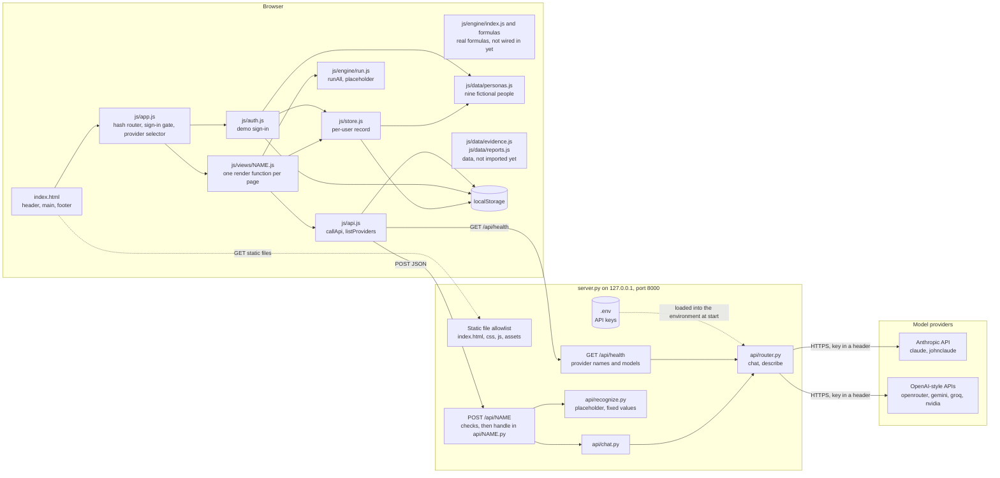
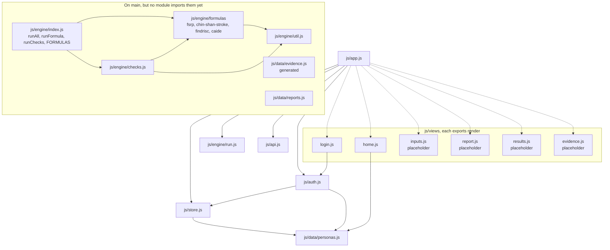
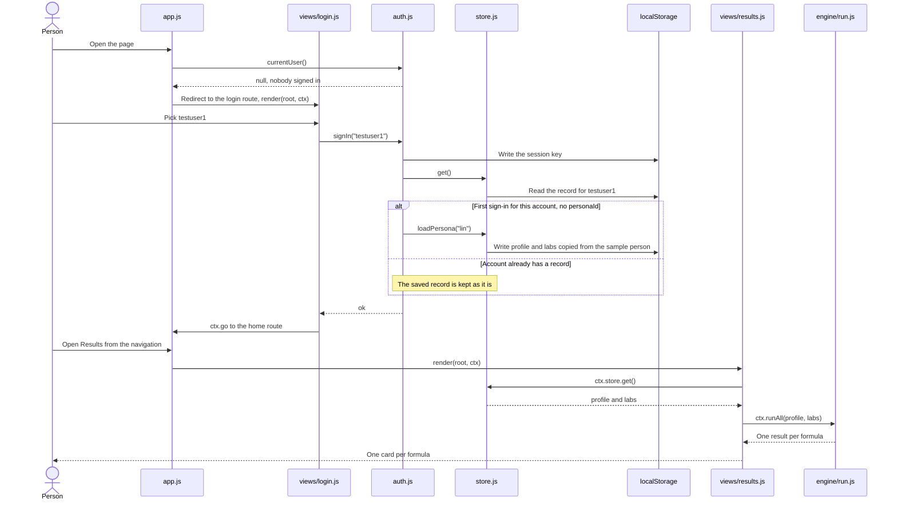
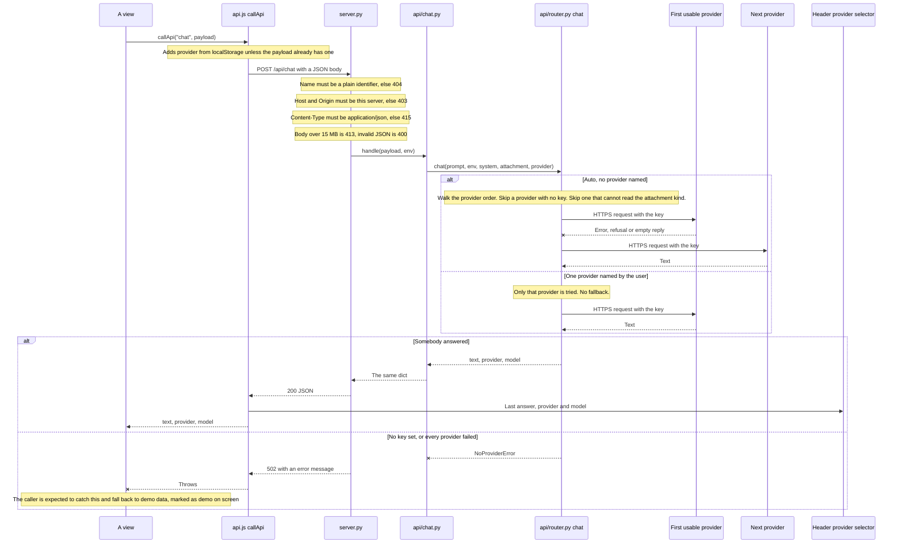

# Architecture

> How unify-risk fits together, as it is on `main` today. The detailed data formats are in [interfaces.md](interfaces.md); the development rules are in [AGENTS.md](../AGENTS.md).
> Several parts are still placeholders that return fixed data. They are marked below, and the [status table](#status-on-main) names the issue or pull request that replaces each one.

## In short

unify-risk is a static web app (plain ES modules, no build step, no packages) plus one standard-library Python server. A person signs in with a demo test account, answers a questionnaire, adds lab values, and sees risk estimates from published formulas, with the evidence for each formula by population.

The main design decisions:

- **Static front end.** `index.html` loads `js/app.js`, a hash router that loads one view module per page on demand. A view that fails to load breaks only its own page.
- **The server is only a key-holding proxy.** `server.py` serves an allowlist of static files and forwards `POST /api/NAME` to `api/NAME.py`. API keys are read from `.env` on the server and never reach the browser.
- **A person's data stays in the browser.** Everything is kept in `localStorage`, one record per signed-in test account. The server stores nothing.
- **Formulas run in the browser.** `runAll(person)` in `js/engine/run.js` is called by the results page; no health data is sent to the server to compute a risk. On `main` the four formulas are in `js/engine/`, but `run.js`, the function the pages call, still returns fixed placeholder results; PR #23 connects the two.
- **One router in front of every model provider.** Server modules call `chat()` in `api/router.py`; it picks a configured provider, falls back to the next one on failure, and reports who answered.

## System overview

Notes on what the diagram shows:

- The dispatch is generic: any `api/NAME.py` that defines `handle(payload, env)` becomes `POST /api/NAME`. `main` has two, `chat` and `recognize`. `api/router.py` has no `handle`, so it is not an endpoint.
- `api/recognize.py` on `main` returns fixed values with `"demo": true` and does not call the router yet.
- `js/engine/index.js` (the real formulas) and the two data modules `js/data/evidence.js` and `js/data/reports.js` are on `main` but have no arrows: nothing imports them yet.
- `assets/sample-reports/` holds fictional lab report files (PDF and PNG). The server serves them, but no page links to them yet.

## Front-end modules

Solid arrows are static `import` statements. Dotted arrows are the on-demand `import()` calls the router makes when a page is opened.

Every view exports one function, `render(root, ctx)`. `root` is the emptied `<main>` element. `ctx` is the same object for every view and is the only way most views reach the rest of the app:

| `ctx` member | Comes from | What it does |
| --- | --- | --- |
| `ctx.store` | `js/store.js` | Read and write the signed-in account's record |
| `ctx.runAll(person)` | `js/engine/run.js` | One result per formula for `{ profile, labs }` |
| `ctx.callApi(name, payload)` | `js/api.js` | `POST /api/NAME`; throws on any failure |
| `ctx.go(hash)` | `js/app.js` | Change page |
| `ctx.query()` | `js/app.js` | Query string after the hash path, as an object |

Two views import a module directly instead of going through `ctx`: `login.js` imports `js/auth.js` (sign-in is not part of `ctx`) and `home.js` imports `js/data/personas.js`. The four placeholder views import nothing.

`js/data/evidence.js` is real generated data (57 formulas by 18 populations, built offline by `tools/build-evidence.mjs`) and exports `STATUS`, `POPULATIONS`, `EVIDENCE` and `getEvidence(modelId, populationId)`. No module on `main` imports it yet; the evidence page that will use it is a placeholder.

The same is true of two more groups of files:

- **The real formula engine.** `js/engine/index.js` exports `runAll`, `runFormula`, `runChecks` and `FORMULAS`, backed by one file per formula in `js/engine/formulas/` (FSRP, Chin-Shan stroke, FINDRISC, CAIDE). `runChecks` re-computes the examples printed in each paper. The app still imports `runAll` from `js/engine/run.js`, the placeholder. The engine's own result shape is not the one in [interfaces.md](interfaces.md) (`id` instead of `modelId`, status `computed` and `not-applicable` instead of `ok` and `not_applicable`), so pages must not import `index.js` directly; PR #23 rewrites `run.js` to call the engine and translate.
- **The dated lab reports.** `js/data/reports.js` exports `REPORTS` and `reportsFor(personId)`, the fictional reports behind the files in `assets/sample-reports/`.

## Main flow: sign in and see results

What is real and what is not in this flow on `main`:

- The sign-in gate, the test accounts and the per-account record are working. Accounts are built from the first three entries of `PERSONAS`: `testuser1` opens `lin`, `testuser2` opens `linda`, `testuser3` opens `chen`.
- The home page lists all nine sample people. Picking one there calls `loadPersona` again, which overwrites the account's profile and labs, then goes straight to the results page.
- `runAll` in `run.js` ignores its argument and returns four fixed results (two `ok`, one `missing`, one `not_applicable`), each flagged `placeholder: true`. The results page prints "placeholder number" on every card, so every account shows the same numbers whoever the sample person is. The questionnaire page has no questions yet.

## AI request flow

Any page can ask a model through `ctx.callApi('chat', { prompt, system, attachment })`. The path below is complete on `main` from `callApi` down to the providers, but **no page on `main` calls `chat` yet**: the lab report page calls `recognize`, which is a placeholder that returns fixed values without using a model.

Details the diagram leaves out:

- **Provider order.** `claude`, `johnclaude`, `openrouter`, `gemini`, `groq`, `nvidia`. `LLM_PROVIDER_ORDER` in `.env` moves the named providers to the front; `NAME_MODEL` (for example `GROQ_MODEL`) overrides a provider's default model.
- **Attachments.** An attachment is a base64 data URL. The two Claude providers read images and PDFs; the others read images only and are skipped for a PDF.
- **The selector.** At page load `app.js` calls `GET /api/health` and fills the header selector with "Auto" plus the providers whose key is set. With no key set the header shows "AI: demo data (no API key set)" instead. A remembered choice whose key is no longer set is forgotten.
- **Last answer.** `callApi` records `provider` and `model` from any API reply that carries a `provider` field and notifies the header. A server module that uses the router should return both fields for this to work.
- **Demo fallback on `main`.** The fallback convention is in [interfaces.md](interfaces.md). On `main` the only caller, the lab report page, shows the error message when `callApi` throws; the "demo data" label it shows comes from the placeholder `api/recognize.py`, which always answers with `"demo": true`.

## Data model

Everything lives in the browser's `localStorage`. Nothing is stored on the server.

| Key | Written by | Value |
| --- | --- | --- |
| `unify-risk:session` | `js/auth.js` | JSON `{ "user": "testuser1" }`. Removed on sign-out. |
| `unify-risk:v1:USER` | `js/store.js` | JSON record for that account, described below. One per test account, so two accounts show two different people. |
| `unify-risk:provider` | `js/api.js` | Plain string: the provider name picked in the header. Absent means "Auto". Shared by all accounts in this browser. |

The per-user record. Missing fields are filled with these defaults on every read:

| Field | Type | Default | Meaning |
| --- | --- | --- | --- |
| `personaId` | string or null | `null` | The sample person this record was copied from. `null` triggers the copy at first sign-in. |
| `profile` | object | `{}` | Questionnaire answers (age, sex, blood pressure, history, habits). |
| `labs` | object | `{}` | Lab values; the unit is part of the key name, for example `hdlMgDl`. |
| `reports` | array | `[]` | Confirmed lab reports, newest first: `{ date, source, labs }`. Adding one merges its `labs` into the record's `labs`. |
| `consentResearch` | boolean | `false` | Research consent flag. Nothing on `main` reads or sets it yet. |

The exact fields of `profile`, `labs`, a lab report and a formula result are in [interfaces.md](interfaces.md). If storage is blocked (for example a private window), reads return the defaults and writes are dropped silently, except sign-in, which reports that it cannot be remembered.

## Security boundaries

- **The server listens on `127.0.0.1` only.** It is a local demo server, not a public deployment.
- **What is served.** `index.html` and files under `css/`, `js/` and `assets/`. The decision is made on the resolved file path, so encoded tricks such as `/js/%2e%2e/.env` fail, and any path with a part that starts with a dot is refused.
- **What is refused.** Everything else is a 404: `.env`, `server.py`, `api/`, `docs/`, `tools/`, `.git`.
- **`GET /api/health`** returns provider names, models and the attachment kinds each reads. It never returns key values.
- **`POST /api/NAME`** runs only a module in `api/` whose name is a plain identifier, does not start with an underscore, and defines `handle`. The `Host` header, and the `Origin` header when sent, must be this server (403 otherwise). The `Content-Type` must be `application/json` (415 otherwise), which a cross-site form cannot send. Bodies over 15 MB are refused (413).
- **Where keys live.** In `.env` (git-ignored) or the real environment; real environment variables win. They are read only by `api/router.py`, sent only to the provider's own API in a request header, and never logged or returned.
- **What reaches the browser.** Static files, the handler's JSON reply, and on failure `{ "error": message }`. The error message can include the first 300 characters of a provider's error response, so a provider's error text is visible to the page; keys are not part of it.
- **Sign-in is a demo.** Test accounts with no password, checked only in the browser. It separates sample people from each other; it does not protect data.
- **Text from people and APIs** is put into the page with `textContent`, not string-built HTML.

## Status on `main`

Owners are the names used in [interfaces.md](interfaces.md).

| Component | State on `main` | Owner | Completed by |
| --- | --- | --- | --- |
| `server.py`: static allowlist, health, API dispatch | Working | Peter | Done |
| `api/router.py`, `api/chat.py`: provider router and chat endpoint | Working; no page calls `chat` yet | Peter | Done |
| `js/app.js`, `js/store.js`, `js/api.js`: router, store, API client, provider selector | Working | Peter | Done |
| `js/auth.js`, `js/views/login.js`: demo sign-in | Working; three test accounts | Peter | Done |
| `js/views/home.js`: pitch and sample people | Working | Peter | Done |
| `js/data/personas.js`: nine fictional sample people | Working | Andrew | Done (PR #10, part of issue #5) |
| `assets/sample-reports/`, `js/data/reports.js`: fictional report files and their values | On `main`; not used by any page yet | Andrew | Used once issue #6 lands (PR #28) |
| `js/engine/index.js`, `js/engine/formulas/`: FSRP, Chin-Shan stroke, FINDRISC, CAIDE | On `main` (PR #12); not called by the app yet | Matt and Andrew | Issue #9; wired in by PR #23 |
| `js/engine/run.js`: the `runAll` the pages call | Placeholder; four fixed results | Matt and Andrew | Issue #19, PR #23 |
| Lab reference standards (`js/engine/labs.js`) | Not on `main` | Matt and Andrew | Issue #9, PR #13 |
| `api/recognize.py`: report recognition | Placeholder; fixed values, `"demo": true`, no model call | Matt | Issue #6, PR #28 |
| `js/views/report.js`: upload and confirm | Placeholder; one button that loads the fixed report | Matt | Issue #6, PR #28 |
| Report interpreter guide | Not on `main` | Issue #11 assignee | Issue #11, PR #24 |
| `js/views/inputs.js`: questionnaire | Placeholder; no questions | Robert | Issue #4, no PR open yet |
| `js/views/results.js`: result cards | Placeholder; plain cards, no equation drawer | Robert | Issue #4, no PR open yet |
| `js/views/evidence.js`: validation matrix | Placeholder; text only | Robert | Issue #4, no PR open yet |
| `js/data/evidence.js`: evidence data | Real generated data; not used by any page yet | Matt | Used once issue #4 builds the evidence page |

## Where to read next

- [interfaces.md](interfaces.md): file owners, routes, and the exact formats modules pass to each other.
- [AGENTS.md](../AGENTS.md): development rules, product wording, Git flow and how to run the app.
