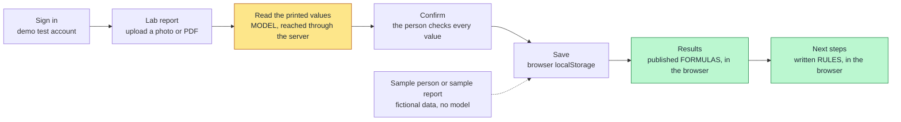
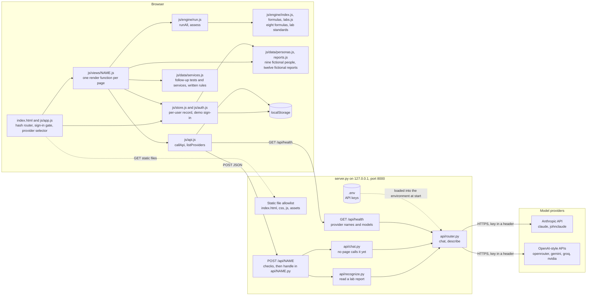
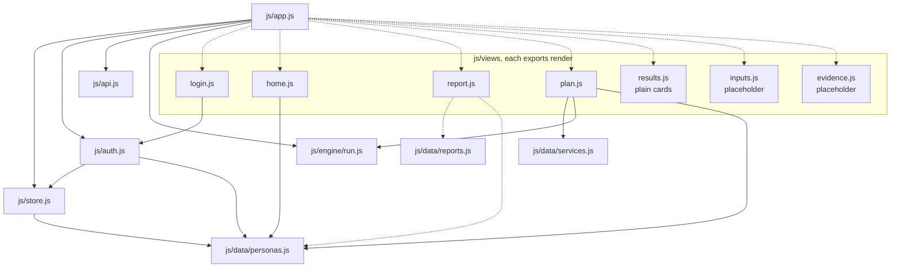
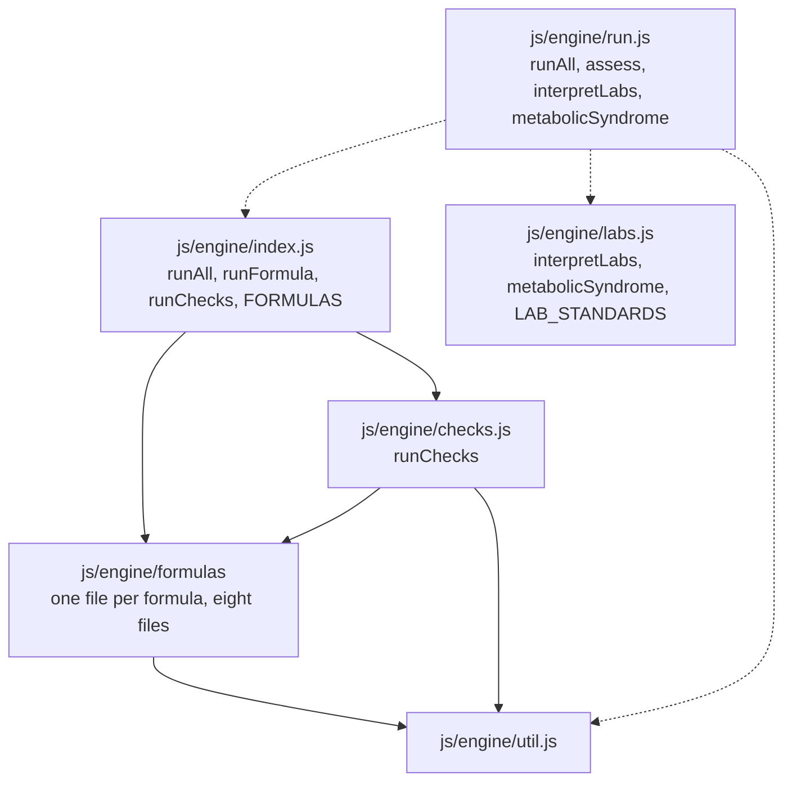
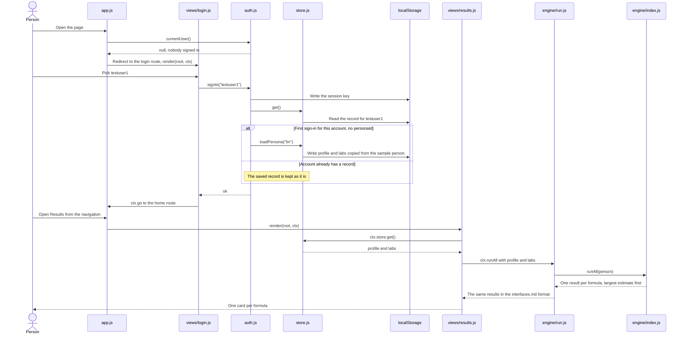
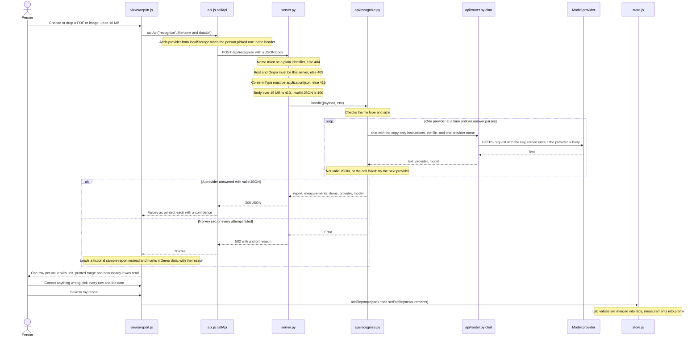
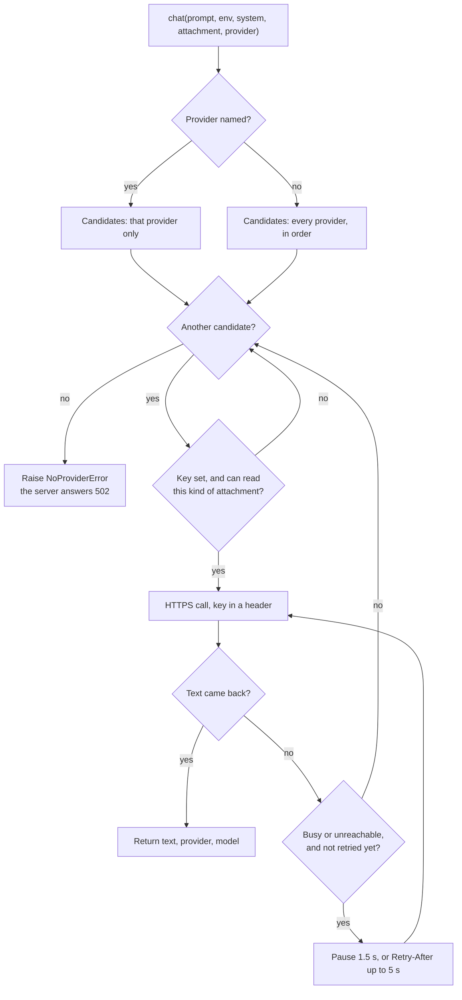

# Architecture

> How unify-risk fits together, as it is on `main` today. The detailed data formats are in [interfaces.md](interfaces.md); the development rules are in [AGENTS.md](../AGENTS.md).
> Three pages are still placeholders or plain first versions. They are marked below, and the [status table](#status-on-main) names the issue or pull request for each.

## In short

unify-risk is a static web app (plain ES modules, no build step, no packages) plus one standard-library Python server. A person signs in with a demo test account, adds a lab report, confirms every value read from it, and sees risk estimates from published formulas, followed by tests and public services worth a look.

A model is used in exactly one place: copying the printed values off an uploaded lab report. Every number after that comes from a published formula or a written rule that runs in the browser.

Yellow is the only step where a model is involved; it copies values and nothing else, and the person confirms each one before it is saved. Green steps are deterministic: the same inputs always give the same output, and no model is called. The questionnaire page is a placeholder today, so answers come from a sample person and from the measurements printed on a report.

The main design decisions:

- **Static front end.** `index.html` loads `js/app.js`, a hash router that loads one view module per page on demand. A view that fails to load breaks only its own page.
- **The server is only a key-holding proxy.** `server.py` serves an allowlist of static files and forwards `POST /api/NAME` to `api/NAME.py`. API keys are read from `.env` on the server and never reach the browser.
- **A person's data stays in the browser.** Everything is kept in `localStorage`, one record per signed-in test account. The server stores nothing. The one thing that leaves the browser is a report file the person chooses to upload, which the server passes to a model provider to be read.
- **Formulas run in the browser.** `js/engine/run.js` adapts the formula engine (`js/engine/index.js`) and the lab reference standards (`js/engine/labs.js`) to the format in [interfaces.md](interfaces.md). No health data is sent to the server to compute an estimate. If the engine fails to load, `run.js` falls back to fixed results flagged `placeholder: true`.
- **Missing and out-of-range are answers.** A formula with a missing input says what is missing; a person outside a formula's range gets "not applicable". Nothing is guessed or extrapolated.
- **One router in front of every model provider.** Server modules call `chat()` in `api/router.py`; it retries a busy provider once, falls back to the next one on failure, and reports who answered.

## System overview

Notes on what the diagram shows:

- The dispatch is generic: any `api/NAME.py` that defines `handle(payload, env)` becomes `POST /api/NAME`. `main` has two, `recognize` and `chat`. `api/router.py` has no `handle`, so it is not an endpoint.
- The only page that calls the server is the lab report page, through `recognize`. `api/chat.py` works but no page on `main` calls it.
- `js/data/evidence.js` (generated validation data) is on `main` but is not in the diagram: no module imports it until the evidence page is built.
- `assets/sample-reports/` holds fictional lab report files (PDF and PNG) for trying the upload. The server serves them, but no page links to them; `tools/check_recognition.py` uses them to compare recognition output with the values they were printed from.

## Front-end modules

Solid arrows are static `import` statements. Dotted arrows are on-demand `import()` calls: the router loads a view when its page is opened, and the report page loads sample data only when it needs it.

Every view exports one function, `render(root, ctx)`. `root` is the emptied `<main>` element. `ctx` is the same object for every view and is the only way most views reach the rest of the app:

| `ctx` member | Comes from | What it does |
| --- | --- | --- |
| `ctx.store` | `js/store.js` | Read and write the signed-in account's record |
| `ctx.runAll(person)` | `js/engine/run.js` | One result per formula for `{ profile, labs }` |
| `ctx.callApi(name, payload)` | `js/api.js` | `POST /api/NAME`; throws on any failure |
| `ctx.go(hash)` | `js/app.js` | Change page |
| `ctx.query()` | `js/app.js` | Query string after the hash path, as an object |

`results.js`, `inputs.js` and `evidence.js` import nothing and use only `ctx`. `js/data/services.js` and `js/engine/labs.js` import nothing either: they are self-contained rules and reference tables.

### The engine

- **`run.js` is the only engine file the app imports.** It loads the other three with `import()` and catches a failure, so a broken engine file degrades to placeholder results instead of a blank app. It translates the engine's own result shape (`id`, status `computed` and `not-applicable`) into the one in [interfaces.md](interfaces.md) (`modelId`, status `ok` and `not_applicable`); pages must not import `index.js` directly.
- **`assess(person)`** returns `{ results, labs, metabolicSyndrome, placeholder }`: the formula results, one row per lab value or measurement with its reference standard and a plain-English reading, and the count of the five Taiwan metabolic syndrome criteria. The Next steps page uses it; the results page still calls `ctx.runAll` and shows the formula results only.
- **Eight formulas** are in `js/engine/formulas/`: revised FSRP and Chin-Shan (stroke); FINDRISC, the Framingham Offspring diabetes score and the ADA risk test (diabetes); CAIDE, the Hisayama equation and BDSI (dementia). Six give a probability. The ADA test and BDSI give points only and are left out unless a caller asks with `includeScores: true`; no page does yet, so the app shows six.
- **Order.** Results come back largest estimate first, then formulas with a missing input, then formulas that do not apply. This is the size of the estimate, not urgency: outcomes and time horizons differ between formulas.
- **`runChecks()`** re-computes the examples printed in each paper (22 checks). Nothing in the app calls it yet; the evidence page is meant to show it.

`js/data/evidence.js` is real generated data (57 formulas by 18 populations, built offline by `tools/build-evidence.mjs`) and exports `STATUS`, `POPULATIONS`, `EVIDENCE` and `getEvidence(modelId, populationId)`. No module on `main` imports it yet; the evidence page that will use it is a placeholder.

## Main flow: sign in and see results

What is real and what is not in this flow on `main`:

- The sign-in gate, the test accounts and the per-account record are working. Accounts are built from the first three entries of `PERSONAS`: `testuser1` opens `lin`, `testuser2` opens `linda`, `testuser3` opens `chen`.
- The home page lists all nine sample people. Picking one there calls `loadPersona` again, which overwrites the account's profile and labs, then goes straight to the results page.
- The numbers are real: each card is computed from the account's own profile and labs, so different people show different estimates. A card shows a percentage, or "Needs" with the missing inputs, or "Not applicable" with the reason.
- The results page itself is still the plain first version: no equation drawer (issue #34), no lab readings and no metabolic syndrome count, although `assess` already returns both.
- The questionnaire page has no questions yet (issue #4). Until it does, a profile comes from a sample person, plus any measurements (height, weight, waist, blood pressure) saved from a lab report.

## Lab report flow: the one place a model is used

Details the diagram leaves out:

- **What the model is asked to do.** Copy the printed values into JSON: test, value, unit, printed range, the report's own high or low flag, and a confidence. The instructions forbid interpreting, calculating, or copying names, ID numbers and other identifying details. The server tidies the answer: a test it has no key for is kept as "other" with the report, and only numeric values under known keys become lab values.
- **Which providers read reports.** With "Auto", `recognize` tries `johnclaude`, then `claude`, then `gemini`, skipping any whose key is not set, and skipping `gemini` for a PDF. When the person picked a provider in the header, only that one is tried.
- **Nothing is saved until it is confirmed.** "Save to my record" stays disabled until every row and the report date are ticked. Rows read with medium or low confidence are highlighted. A row can be corrected, re-assigned, removed, or added by hand.
- **Units are checked, not converted.** A printed unit that differs from the one the app expects gets a warning on its row; the value is saved as it stands. Conversion is in PR #45, not on `main`.
- **Demo fallback.** If the call fails for any reason, the page loads a fictional report from `js/data/reports.js` (the one matching the file name if it is a sample file, otherwise the newest for the account's sample person) and shows a "Demo data" note with the reason. "Use a sample report" does the same without calling the server. The saved report keeps `demo: true`.

### Inside the router

`chat()` in `api/router.py` is the only code that talks to a provider.

- **Provider order.** `claude`, `johnclaude`, `openrouter`, `gemini`, `groq`, `nvidia`. `LLM_PROVIDER_ORDER` in `.env` moves the named providers to the front; `NAME_MODEL` (for example `GROQ_MODEL`) overrides a provider's default model.
- **Retry.** "Busy or unreachable" means HTTP 429, 500, 502, 503 or 504, or a network error. It gets one more try on the same provider. Other errors (400, 401, 403, 404), a refusal, an empty reply and a full timeout are not retried. Both attempts share one 90-second budget, and there is no retry with less than 20 seconds of it left.
- **Attachments.** An attachment is a base64 data URL. The two Claude providers read images and PDFs; the others read images only and are skipped for a PDF.
- **The selector.** At page load `app.js` calls `GET /api/health`, which lists the providers whose key is set with the model each will use, and fills the header selector with "Auto" plus those providers. With no key set the header shows "AI: demo data (no API key set)" instead. A remembered choice whose key is no longer set is forgotten. `callApi` adds the choice to every request as `provider`.
- **Last answer.** `callApi` records `provider` and `model` from any API reply that carries a `provider` field, and the header shows them as "Last answer".
- **`POST /api/chat`** exposes `chat()` directly: `ctx.callApi('chat', { prompt, system, attachment })`. No page on `main` calls it.

## Next steps: rules, not a model

The Next steps page (`#/plan`, `js/views/plan.js`) calls `assess` for the account's record and passes the outcome to two functions in `js/data/services.js`:

- `followUpTests` suggests at most three tests: first a lab reading outside its reference standard (repeat it), then a test or answer a formula listed as missing, then what is needed to settle the metabolic syndrome count.
- `matchingServices` lists public services in Taiwan or the United States whose published eligibility rule the person's own values meet, with the values that matched and a link to the official source.

Both are plain `if` rules over the record and the engine's output. No model is called and no new number is produced: every figure shown is copied from the person's record or is part of a published rule. A switch on the page changes the region and saves it in the record. Issue #46 tracks two known gaps: the follow-up list is cut at three without saying so, and some service rules were not re-checked against their source.

## Data model

Everything lives in the browser's `localStorage`. Nothing is stored on the server.

| Key | Written by | Value |
| --- | --- | --- |
| `unify-risk:session` | `js/auth.js` | JSON `{ "user": "testuser1" }`. Removed on sign-out. |
| `unify-risk:v1:USER` | `js/store.js` | JSON record for that account, described below. One per test account, so two accounts show two different people. |
| `unify-risk:provider` | `js/api.js` | Plain string: the provider name picked in the header. Absent means "Auto". Shared by all accounts in this browser. |

The per-user record. Missing fields are filled with these defaults on every read:

| Field | Type | Default | Meaning |
| --- | --- | --- | --- |
| `personaId` | string or null | `null` | The sample person this record was copied from. `null` triggers the copy at first sign-in. |
| `profile` | object | `{}` | Answers and measurements (age, sex, height, weight, waist, blood pressure, history, habits). |
| `labs` | object | `{}` | Lab values; the unit is part of the key name, for example `hdlMgDl`. |
| `reports` | array | `[]` | Confirmed lab reports, most recently saved first; see below. |
| `region` | `'TW'` or `'US'` | absent | Written by the switch on the Next steps page. When absent, the sample person's region is used, then `'TW'`. |
| `consentResearch` | boolean | `false` | Research consent flag. Nothing on `main` reads or sets it yet. |

A saved report, as the lab report page writes it:

| Field | Meaning |
| --- | --- |
| `date` | Report date, `YYYY-MM-DD`, confirmed by the person |
| `source` | The uploaded file's name, or a sample label |
| `labs` | Lab values under the same keys as the record's `labs` |
| `measurements` | Height, weight, waist and blood pressure printed on the report |
| `items` | Every confirmed row: `{ key, label, value, unit, range, flag }`, including tests the app has no key for |
| `lab` | Clinic or laboratory name as printed |
| `demo` | `true` when the values came from a fictional sample report |

Saving a report merges its `labs` into the record's `labs` and its `measurements` into `profile`. The merge does not look at dates, so saving an older report after a newer one overwrites the newer values; PR #45 addresses this.

The exact fields of `profile`, `labs` and a formula result are in [interfaces.md](interfaces.md). If storage is blocked (for example a private window), reads return the defaults and writes are dropped silently, except sign-in, which reports that it cannot be remembered.

## Security boundaries

- **The server listens on `127.0.0.1` only.** It is a local demo server, not a public deployment.
- **What is served.** `index.html` and files under `css/`, `js/` and `assets/`. The decision is made on the resolved file path, so encoded tricks such as `/js/%2e%2e/.env` fail, and any path with a part that starts with a dot is refused.
- **What is refused.** Everything else is a 404: `.env`, `server.py`, `api/`, `docs/`, `tools/`, `.git`.
- **`GET /api/health`** returns provider names, models and the attachment kinds each reads. It never returns key values.
- **`POST /api/NAME`** runs only a module in `api/` whose name is a plain identifier, does not start with an underscore, and defines `handle`. The `Host` header, and the `Origin` header when sent, must be this server (403 otherwise). The `Content-Type` must be `application/json` (415 otherwise), which a cross-site form cannot send. Bodies over 15 MB are refused (413).
- **Where keys live.** In `.env` (git-ignored) or the real environment; real environment variables win. They are read only by `api/router.py`, sent only to the provider's own API in a request header, and never logged or returned.
- **What leaves the machine.** Only a report file the person uploads, sent to one model provider to be read. Profile answers, lab values, results and next steps are never sent to the server. The model is told not to copy names, ID numbers or other identifying details, but the file itself is sent whole.
- **What reaches the browser.** Static files, the handler's JSON reply, and on failure `{ "error": message }`. `recognize` reduces a provider failure to a status code or a short reason. `chat` passes on the router's message, which can include the first 300 characters of a provider's error response; the router replaces the key with `[key]` if a provider ever echoes it.
- **Sign-in is a demo.** Test accounts with no password, checked only in the browser. It separates sample people from each other; it does not protect data.
- **Text from people, files and APIs** is put into the page with `textContent` or text nodes, not string-built HTML.

## Status on `main`

Owners are the names used in [interfaces.md](interfaces.md).

| Component | State on `main` | Owner | Issue or PR |
| --- | --- | --- | --- |
| `server.py`: static allowlist, health, API dispatch | Working | Peter | Done |
| `api/router.py`: provider router with one retry and fallback | Working | Peter | Done (PR #21, PR #44) |
| `api/chat.py`: chat endpoint | Working; no page calls it | Peter | Done (PR #21) |
| `js/app.js`, `js/store.js`, `js/api.js`: router, store, API client, provider selector | Working | Peter | Done |
| `js/auth.js`, `js/views/login.js`: demo sign-in | Working; three test accounts | Peter | Done |
| `js/views/home.js`: pitch and sample people | Working; "Start with your own answers" leads to the placeholder questionnaire | Peter | Done |
| `js/data/personas.js`: nine fictional sample people | Working | Andrew | Done (PR #10) |
| `js/data/reports.js`, `assets/sample-reports/`: twelve fictional dated reports, ten printed files | Working; used as the demo fallback and to check recognition | Andrew | Done (PR #10, PR #20) |
| `js/engine/index.js`, `js/engine/formulas/`: eight formulas, largest estimate first | Working; the two point scores are not shown yet | Matt and Andrew | Issue #9 (open) |
| `js/engine/labs.js`: lab reference standards, metabolic syndrome count | Working; shown through Next steps only | Matt and Andrew | Done (PR #13, PR #40) |
| `js/engine/run.js`: `runAll` and `assess`, the engine as the pages see it | Working; placeholder numbers only if the engine fails to load | Matt and Andrew | Done (PR #23, PR #38) |
| `api/recognize.py`, `js/views/report.js`: read a report, confirm each value, save | Working with a provider key; demo data without one | Matt | Done (PR #28) |
| Unit conversion and date handling on the report page | Not on `main` | Andrew | Issue #42, PR #45 (open) |
| `js/views/plan.js`, `js/data/services.js`: Next steps | Working; rules only, no model | Peter | Done (PR #41); follow-up in issue #46 |
| `docs/report-interpreter.md`: instructions for a report-writing model | On `main`; nothing in the app uses it yet | Andrew | Done (PR #24); used by PR #43 |
| "Explained" page: AI-written reading of the results, with what-ifs | Not on `main` | Andrew | Issue #37, PR #43 (open) |
| `js/views/results.js`: result cards | Real numbers on plain cards; no lab readings | Robert | Issue #4 |
| Equation drawer: open a result to see its terms, equation and source | Not built; the engine already returns the data | Robert | Issue #34, no PR yet |
| `js/views/inputs.js`: questionnaire | Placeholder; no questions | Robert | Issue #4, no PR yet |
| `js/views/evidence.js`: validation matrix and check table | Placeholder; text only | Robert | Issue #33, no PR yet |
| `js/data/evidence.js`: evidence data | Real generated data; not used by any page yet | Matt | Used once issue #33 builds the evidence page |

## Where to read next

- [interfaces.md](interfaces.md): file owners, routes, and the exact formats modules pass to each other.
- [AGENTS.md](../AGENTS.md): development rules, product wording, Git flow and how to run the app.
